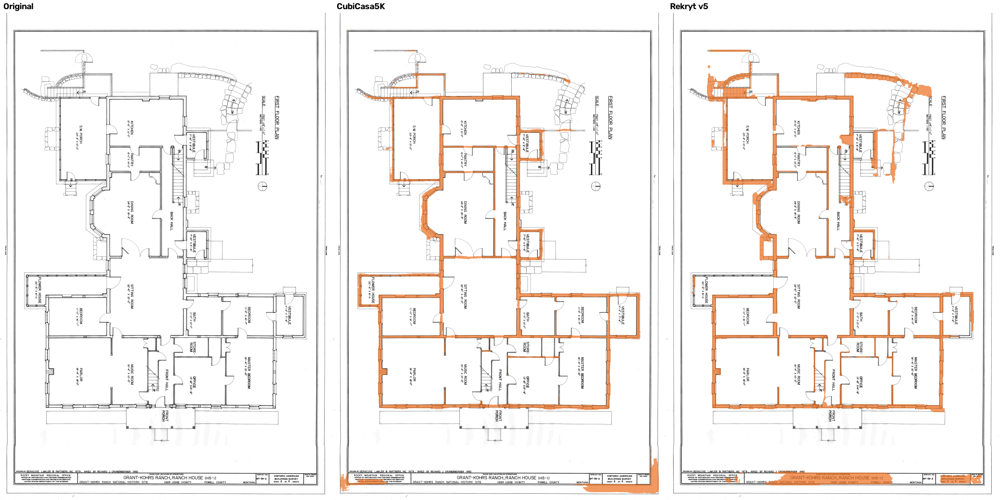
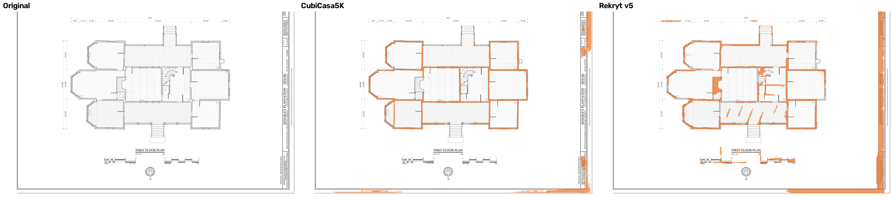
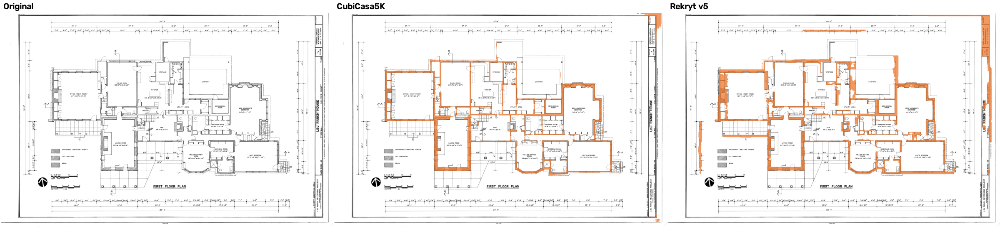

# HABS: real, public-domain floor plans

Ten measured floor plans from the **Historic American Buildings Survey** (U.S. National Park Service). They are works of
the U.S. government and in the **public domain**. Each sheet is shown as **original | CubiCasa5K | Rekryt v5**, walls in the same colour.

These sheets have no ground truth, so no scores are given.

## Sheet 07

Source: [First Floor Plan - E. Fay and Gus Jones House, 1330 North Hillcrest Avenue, Fayetteville, Washington County, AR HABS AR-52 (sheet 3 of 23).tif](https://commons.wikimedia.org/wiki/File:First_Floor_Plan_-_E._Fay_and_Gus_Jones_House,_1330_North_Hillcrest_Avenue,_Fayetteville,_Washington_County,_AR_HABS_AR-52_(sheet_3_of_23).tif), Historic American Buildings Survey, public domain.

## Sheet 13

Source: [First Floor Plan - Scott-Grant House, 3238 R Street, Northwest, Washington, District of Columbia, DC HABS DC,GEO,242- (sheet 2 of 3).tif](https://commons.wikimedia.org/wiki/File:First_Floor_Plan_-_Scott-Grant_House,_3238_R_Street,_Northwest,_Washington,_District_of_Columbia,_DC_HABS_DC,GEO,242-_(sheet_2_of_3).tif), Historic American Buildings Survey, public domain.

## Sheet 10

Source: [First Floor Plan - Long-Sanchez House, 43 Marine Street, Saint Augustine, St. Johns County, FL HABS FLA,55-SAUG,30- (sheet 2 of 9).tif](https://commons.wikimedia.org/wiki/File:First_Floor_Plan_-_Long-Sanchez_House,_43_Marine_Street,_Saint_Augustine,_St._Johns_County,_FL_HABS_FLA,55-SAUG,30-_(sheet_2_of_9).tif), Historic American Buildings Survey, public domain.

## Sheet 04

Source: [First Floor Plan - Bryan Lathrop House, 120 East Bellevue Place, Chicago, Cook County, IL HABS ILL,16-CHIG,40- (sheet 2 of 16).tif](https://commons.wikimedia.org/wiki/File:First_Floor_Plan_-_Bryan_Lathrop_House,_120_East_Bellevue_Place,_Chicago,_Cook_County,_IL_HABS_ILL,16-CHIG,40-_(sheet_2_of_16).tif), Historic American Buildings Survey, public domain.

## Sheet 08

Source: [First Floor Plan - Grant-Kohrs Ranch, Ranch House, Highway 10, Deer Lodge, Powell County, MT HABS MONT,39-DELO,1-A- (sheet 2 of 5).tif](https://commons.wikimedia.org/wiki/File:First_Floor_Plan_-_Grant-Kohrs_Ranch,_Ranch_House,_Highway_10,_Deer_Lodge,_Powell_County,_MT_HABS_MONT,39-DELO,1-A-_(sheet_2_of_5).tif), Historic American Buildings Survey, public domain.

## Sheet 09

Source: [First Floor Plan - Hantz House, 855 Fairview Drive, Fayetteville, Washington County, AR HABS AR-54 (sheet 4 of 12).tif](https://commons.wikimedia.org/wiki/File:First_Floor_Plan_-_Hantz_House,_855_Fairview_Drive,_Fayetteville,_Washington_County,_AR_HABS_AR-54_(sheet_4_of_12).tif), Historic American Buildings Survey, public domain.

## Sheet 14

Source: [First Floor Plan - W. Arms House, 648 Wick Avenue, Youngstown, Mahoning County, OH HABS OH-2479 (sheet 3 of 13).tif](https://commons.wikimedia.org/wiki/File:First_Floor_Plan_-_W._Arms_House,_648_Wick_Avenue,_Youngstown,_Mahoning_County,_OH_HABS_OH-2479_(sheet_3_of_13).tif), Historic American Buildings Survey, public domain.

## Sheet 15

Source: [First floor plan - Kingsley Plantation, House, 11676 Palmetto Avenue, Jacksonville, Duval County, FL HABS FL-478-B (sheet 2 of 10).tif](https://commons.wikimedia.org/wiki/File:First_floor_plan_-_Kingsley_Plantation,_House,_11676_Palmetto_Avenue,_Jacksonville,_Duval_County,_FL_HABS_FL-478-B_(sheet_2_of_10).tif), Historic American Buildings Survey, public domain.

## Sheet 16

Source: [First floor plan - Lyndon B. Johnson Ranch, House, Park Road 49, Stonewall, Gillespie County, TX HABS TX-3328-A (sheet 2 of 6).tif](https://commons.wikimedia.org/wiki/File:First_floor_plan_-_Lyndon_B._Johnson_Ranch,_House,_Park_Road_49,_Stonewall,_Gillespie_County,_TX_HABS_TX-3328-A_(sheet_2_of_6).tif), Historic American Buildings Survey, public domain.

## Sheet 19

Source: [Main Floor Plan - Durst House, 857 Fairview Drive, Fayetteville, Washington County, AR HABS AR-55 (sheet 3 of 13).tif](https://commons.wikimedia.org/wiki/File:Main_Floor_Plan_-_Durst_House,_857_Fairview_Drive,_Fayetteville,_Washington_County,_AR_HABS_AR-55_(sheet_3_of_13).tif), Historic American Buildings Survey, public domain.
