# HABS: real, public-domain floor plans

Seventeen measured floor plans from the **Historic American Buildings Survey** (U.S. National Park Service). They are works of
the U.S. government and in the **public domain**. Each sheet is shown as **original | CubiCasa5K | Rekryt v5**, with walls in the same colour.

There is **no ground truth** for these sheets, so there are no scores. The verdicts below are **judged by eye** from the images.
The difficulty order is computed from the images themselves (contrast, noise, small details, hatching), not from the
models' results, so it does not favour either model. Only the two hardest sheets stand out clearly; below rank 5 the order is
close to a tie.

| Rank | Sheet | What makes it hard | Cleaner result | Notes |
|---:|---|---|---|---|
| 1 | [01](#sheet-01) | Faded, low-contrast photo of a blueprint on dark paper, handwriting, shaded edges | CubiCasa5K | Rekryt finds only fragments of the outer walls; CubiCasa5K gives a reasonable outline but marks the sheet frame. |
| 2 | [02](#sheet-02) | Old hand-drawn plan on stained, creased paper, black scan border, thin lines | Even | Both find outer and most inner walls; CubiCasa5K marks the whole black scan border, Rekryt parts of it and misses a few inner walls. |
| 3 | [04](#sheet-04) | Dense hatching and patterned fills, a lot of text on a large sheet | Even | Both find outer and inner walls; Rekryt draws hatched fields thicker. |
| 4 | [10](#sheet-10) | Masonry in heavy stippled hatching, many dimension lines, running text | CubiCasa5K | CubiCasa5K is cleaner; Rekryt gets the thick outer wall but misses inner walls and hits the hatched field. |
| 5 | [07](#sheet-07) | Stone-patterned ground and hatched masonry in the same tone as the walls | Rekryt | Rekryt follows the thick hatched masonry; CubiCasa5K misses it and hits the stone-patterned ground. |
| 6 | [16](#sheet-16) | Many small rooms, dense dimensioning around the plan, hatched fields | CubiCasa5K | CubiCasa5K is cleaner; Rekryt has false hits along dimension lines. |
| 7 | [09](#sheet-09) | Thin walls, hatched floor areas, a dark field in the wall | CubiCasa5K | CubiCasa5K is clean; Rekryt has false vertical strokes and specks. |
| 8 | [17](#sheet-17) | Organic plan with round and angled rooms, garden walls, many details | Even | Both find outer and many inner walls, both hit the title block. |
| 9 | [13](#sheet-13) | Octagonal sunroom with patterned floor and diagonal hatching | Rekryt | Rekryt finds the plan incl. the octagonal room without the frame; CubiCasa5K marks the frame heavily. |
| 10 | [19](#sheet-19) | Long thin walls, open deck with dashed lines, many dimension lines | CubiCasa5K | CubiCasa5K is clean; Rekryt hits dimension lines and the deck. |
| 11 | [08](#sheet-08) | Tall sheet, garden walls outside the house, text in several directions | CubiCasa5K (slightly) | Both find the house; Rekryt also marks garden masonry and the title block. |
| 12 | [14](#sheet-14) | Thick hatched masonry walls, many small rooms, text in several sizes | Even | Rekryt fills the thick hatched walls but misses some inner walls; CubiCasa5K a little false. |
| 13 | [12](#sheet-12) | Thin walls, hatched stairs and porch | Even | Both find the walls with some false hits at the sheet edge. |
| 14 | [06](#sheet-06) | Clean plan with light wall and porch hatching | Rekryt (slightly) | Both find the walls; CubiCasa5K marks the right and bottom edge. |
| 15 | [15](#sheet-15) | Double thin walls and floor hatching | CubiCasa5K | Rekryt misses several inner walls and hits a fireplace and the scale bar. |
| 16 | [20](#sheet-20) | Two plans (basement and floor) on one sheet, thin walls | CubiCasa5K | CubiCasa5K is nearly clean on both plans; Rekryt has false specks along the left edge. |
| 17 | [05](#sheet-05) | Clean plan with double walls and a lot of text | CubiCasa5K (slightly) | Both find the walls; Rekryt hits dimension lines. |

**Tally:** Rekryt cleaner on 3 sheets, even on 5, CubiCasa5K cleaner on 9.

## All sheets

### Sheet 01

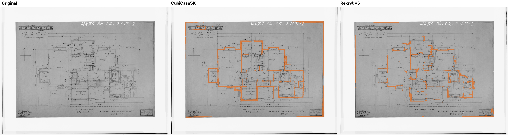

Source: [FIRST FLOOR PLAN, 1906 - Mary Cossitt House, 3526 Seventh Avenue, San Diego, San Diego County, CA](https://commons.wikimedia.org/wiki/File:FIRST_FLOOR_PLAN,_1906_-_Mary_Cossitt_House,_3526_Seventh_Avenue,_San_Diego,_San_Diego_County,_CA_HABS_CAL,37-SANDI,17-2.tif), Historic American Buildings Survey, public domain.

### Sheet 02

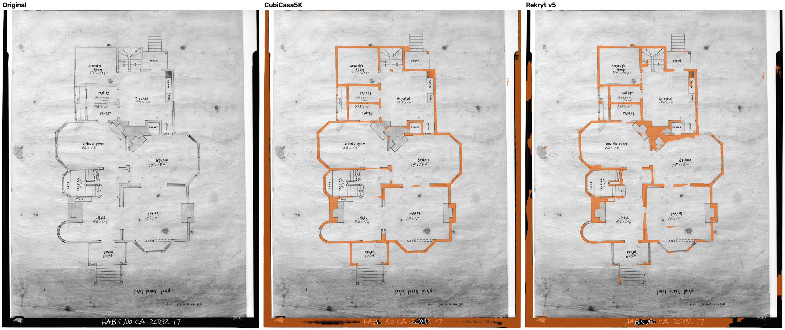

Source: [FIRST FLOOR PLAN - Riddell Fish House, 245 West K Street, Benicia, Solano County, CA](https://commons.wikimedia.org/wiki/File:FIRST_FLOOR_PLAN_-_Riddell_Fish_House,_245_West_K_Street,_Benicia,_Solano_County,_CA_HABS_CAL,48-BENI,8-17.tif), Historic American Buildings Survey, public domain.

### Sheet 04

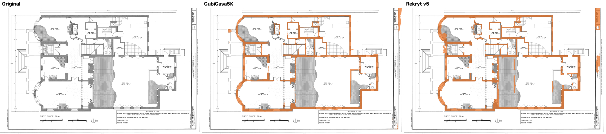

Source: [First Floor Plan - Bryan Lathrop House, 120 East Bellevue Place, Chicago, Cook County, IL](https://commons.wikimedia.org/wiki/File:First_Floor_Plan_-_Bryan_Lathrop_House,_120_East_Bellevue_Place,_Chicago,_Cook_County,_IL_HABS_ILL,16-CHIG,40-_(sheet_2_of_16).tif), Historic American Buildings Survey, public domain.

### Sheet 10

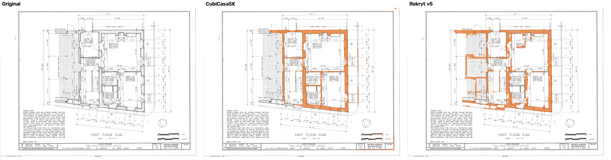

Source: [First Floor Plan - Long-Sanchez House, 43 Marine Street, Saint Augustine, St. Johns County, FL](https://commons.wikimedia.org/wiki/File:First_Floor_Plan_-_Long-Sanchez_House,_43_Marine_Street,_Saint_Augustine,_St._Johns_County,_FL_HABS_FLA,55-SAUG,30-_(sheet_2_of_9).tif), Historic American Buildings Survey, public domain.

### Sheet 07

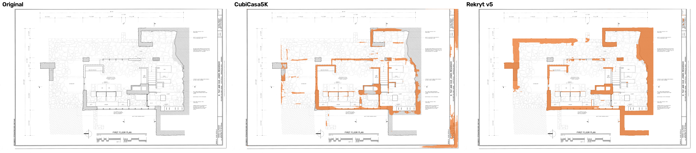

Source: [First Floor Plan - E. Fay and Gus Jones House, 1330 North Hillcrest Avenue, Fayetteville, Washington County, AR](https://commons.wikimedia.org/wiki/File:First_Floor_Plan_-_E._Fay_and_Gus_Jones_House,_1330_North_Hillcrest_Avenue,_Fayetteville,_Washington_County,_AR_HABS_AR-52_(sheet_3_of_23).tif), Historic American Buildings Survey, public domain.

### Sheet 16

Source: [First floor plan - Lyndon B. Johnson Ranch, House, Park Road 49, Stonewall, Gillespie County, TX](https://commons.wikimedia.org/wiki/File:First_floor_plan_-_Lyndon_B._Johnson_Ranch,_House,_Park_Road_49,_Stonewall,_Gillespie_County,_TX_HABS_TX-3328-A_(sheet_2_of_6).tif), Historic American Buildings Survey, public domain.

### Sheet 09

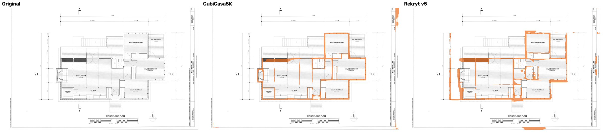

Source: [First Floor Plan - Hantz House, 855 Fairview Drive, Fayetteville, Washington County, AR](https://commons.wikimedia.org/wiki/File:First_Floor_Plan_-_Hantz_House,_855_Fairview_Drive,_Fayetteville,_Washington_County,_AR_HABS_AR-54_(sheet_4_of_12).tif), Historic American Buildings Survey, public domain.

### Sheet 17

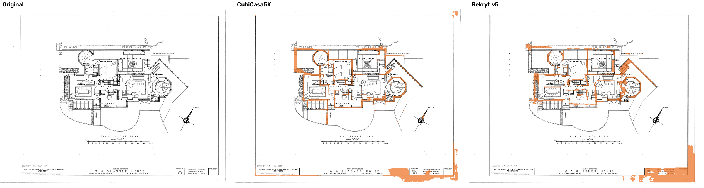

Source: [First floor plan - W. A. Glasner House, 850 Sheridan Road, Glencoe, Cook County, IL](https://commons.wikimedia.org/wiki/File:First_floor_plan_-_W._A._Glasner_House,_850_Sheridan_Road,_Glencoe,_Cook_County,_IL_HABS_ILL,16-GLENC,2-_(sheet_2_of_4).tif), Historic American Buildings Survey, public domain.

### Sheet 13

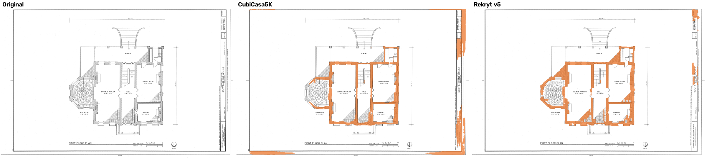

Source: [First Floor Plan - Scott-Grant House, 3238 R Street, Northwest, Washington, District of Columbia, DC](https://commons.wikimedia.org/wiki/File:First_Floor_Plan_-_Scott-Grant_House,_3238_R_Street,_Northwest,_Washington,_District_of_Columbia,_DC_HABS_DC,GEO,242-_(sheet_2_of_3).tif), Historic American Buildings Survey, public domain.

### Sheet 19

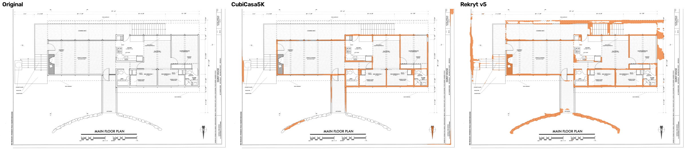

Source: [Main Floor Plan - Durst House, 857 Fairview Drive, Fayetteville, Washington County, AR](https://commons.wikimedia.org/wiki/File:Main_Floor_Plan_-_Durst_House,_857_Fairview_Drive,_Fayetteville,_Washington_County,_AR_HABS_AR-55_(sheet_3_of_13).tif), Historic American Buildings Survey, public domain.

### Sheet 08

Source: [First Floor Plan - Grant-Kohrs Ranch, Ranch House, Highway 10, Deer Lodge, Powell County, MT](https://commons.wikimedia.org/wiki/File:First_Floor_Plan_-_Grant-Kohrs_Ranch,_Ranch_House,_Highway_10,_Deer_Lodge,_Powell_County,_MT_HABS_MONT,39-DELO,1-A-_(sheet_2_of_5).tif), Historic American Buildings Survey, public domain.

### Sheet 14

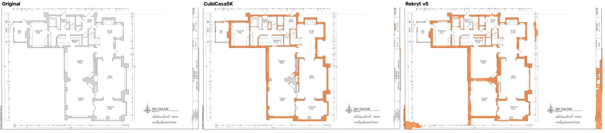

Source: [First Floor Plan - W. Arms House, 648 Wick Avenue, Youngstown, Mahoning County, OH](https://commons.wikimedia.org/wiki/File:First_Floor_Plan_-_W._Arms_House,_648_Wick_Avenue,_Youngstown,_Mahoning_County,_OH_HABS_OH-2479_(sheet_3_of_13).tif), Historic American Buildings Survey, public domain.

### Sheet 12

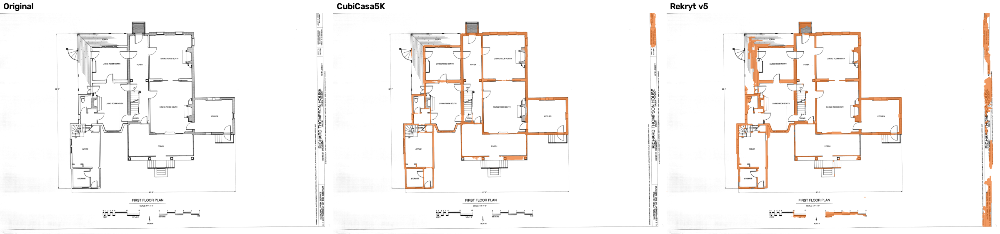

Source: [First Floor Plan - Richard Thompson House, 109 West Broadway, Salem, Salem County, NJ](https://commons.wikimedia.org/wiki/File:First_Floor_Plan_-_Richard_Thompson_House,_109_West_Broadway,_Salem,_Salem_County,_NJ_HABS_NJ-1256_(sheet_3_of_6).tif), Historic American Buildings Survey, public domain.

### Sheet 06

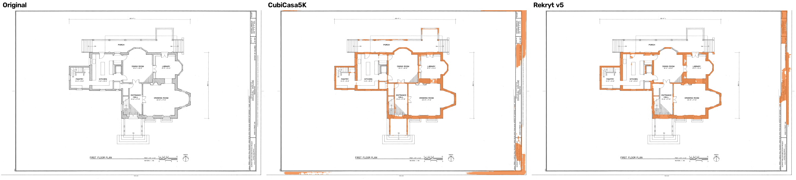

Source: [First Floor Plan - Dougal House, 3259 R Street, Northwest, Washington, District of Columbia, DC](https://commons.wikimedia.org/wiki/File:First_Floor_Plan_-_Dougal_House,_3259_R_Street,_Northwest,_Washington,_District_of_Columbia,_DC_HABS_DC,GEO,233-_(sheet_2_of_3).tif), Historic American Buildings Survey, public domain.

### Sheet 15

Source: [First floor plan - Kingsley Plantation, House, 11676 Palmetto Avenue, Jacksonville, Duval County, FL](https://commons.wikimedia.org/wiki/File:First_floor_plan_-_Kingsley_Plantation,_House,_11676_Palmetto_Avenue,_Jacksonville,_Duval_County,_FL_HABS_FL-478-B_(sheet_2_of_10).tif), Historic American Buildings Survey, public domain.

### Sheet 20

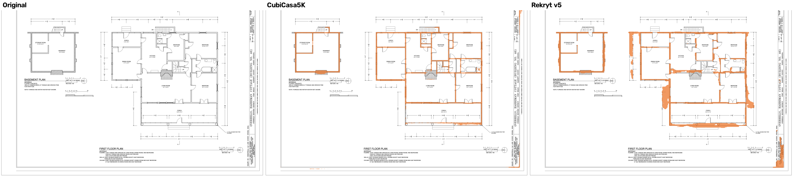

Source: [Basement and First Floor Plan - Overhills, Harriman Cottage, West of Thurman Road and East of Overhills Golf Course, Overhills, Harnett County, NC](https://commons.wikimedia.org/wiki/File:Basement_and_First_Floor_Plan_-_Overhills,_Harriman_Cottage,_West_of_Thurman_Road_and_East_of_Overhills_Golf_Course,_Overhills,_Harnett_County,_NC_HABS_NC-407-AA_(sheet_2_of_8).tif), Historic American Buildings Survey, public domain.

### Sheet 05

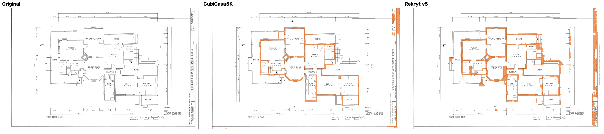

Source: [First Floor Plan - Charles Goodnight Ranch House, Goodnight, Armstrong County, TX](https://commons.wikimedia.org/wiki/File:First_Floor_Plan_-_Charles_Goodnight_Ranch_House,_Goodnight,_Armstrong_County,_TX_HABS_TX-3529_(sheet_2_of_9).tif), Historic American Buildings Survey, public domain.
