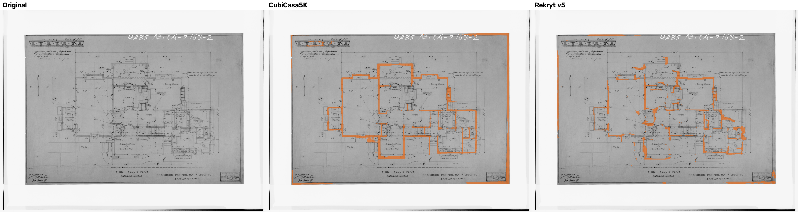

# Rekryt: wall detection for house floor plans

Rekryt is the wall detector in VDB, a Swedish house-design CAD application. You upload a floor-plan image, Rekryt finds
the walls, and VDB turns them into an editable drawing. The AI architect can then change that drawing on request.

**Training data:** Rekryt is trained from scratch on openly licensed data
([Swiss Dwellings](https://zenodo.org/records/7788422) by Archilyse AG, CC BY 4.0) and VDB's own synthetic drawings.

This repository holds results only. The model, the training data and the application code are not published.
Every comparison here is shown as it came out, including the cases where Rekryt loses.

## Summary

| Test | Rekryt v5 | CubiCasa5K | Verdict |
|---|---|---|---|
| 17 real, public-domain plans ([HABS](HABS.md)), judged by eye | cleaner on 3 | cleaner on 9 | even on 5 |
| 57 of VDB's own CAD drawings, F1 against exact ground truth | **0.971** | 0.968 | practically even |
| 122 scanned real plans (CVC-FP), F1 | **0.881** | – | – |

**What the comparison supports:** Rekryt is comparable with CubiCasa5K on hard scanned drawings. It is better on thick
hatched masonry and at leaving the sheet frame alone. CubiCasa5K is cleaner on faded scans and on sheets with many
dimension lines. Rekryt can be used commercially; CubiCasa5K's weights are licensed CC BY-NC.

## Real drawings: HABS, public domain

Measured floor plans of real houses from the **Historic American Buildings Survey**, all in the public domain. There is
no ground truth, so these are judged by eye; see **[HABS.md](HABS.md)** for all 17 sheets, the difficulty order and a note per sheet.
Panels: **original | CubiCasa5K | Rekryt v5**.

**Where Rekryt does best: thick hatched masonry on stone-patterned ground (difficulty rank 5 of 17)**

**Where Rekryt does best: a plan with an octagonal room, without marking the sheet frame (rank 9)**

**Where Rekryt does worst: a faded photo of a blueprint, the hardest sheet (rank 1)**

**Where Rekryt does worst: heavy stippled masonry and many dimension lines (rank 4)**

## VDB's own drawings

57 plans exported from VDB itself: 17 start houses and 40 generated houses. The ground truth comes straight from the
drawing's own geometry. The whole sheet goes in as an uploaded drawing would, frame and title block included.
Panels: **original | ground truth | CubiCasa5K | Rekryt v5**.

| Model | Precision | Recall | F1 mean | F1 median | F1 min–max |
|---|---:|---:|---:|---:|---:|
| **Rekryt v5** | 0.948 | 0.997 | **0.971** | 0.975 | **0.937**–0.992 |
| CubiCasa5K, best of two input sizes | 0.942 | 0.996 | 0.968 | 0.970 | 0.915–0.986 |
| CubiCasa5K, other input size | 0.927 | 0.989 | 0.957 | 0.964 | 0.747–0.983 |

On clean CAD drawings both models are close to the ceiling, so this set says little about which one is better.

## Real drawings with ground truth

| Set | n | Precision | Recall | F1 mean | F1 median | F1 min–max |
|---|---:|---:|---:|---:|---:|---:|
| CVC-FP (scanned floor plans, research dataset) | 122 | 0.807 | 0.973 | 0.881 | 0.886 | 0.573–0.951 |
| Real archive drawings | 34 | 0.792 | 0.937 | 0.845 | 0.867 | 0.518–0.997 |

These sheets cannot be shown here for licence reasons, so only the numbers are given.

## How it is measured

- **Recall** is the share of ground-truth wall pixels a model finds. **Precision** is the share of a model's wall pixels
  that lie on a real wall. A pixel counts as a hit within max(2 px, 0.4 % of the image's longest side).
- CubiCasa5K is the official pretrained model (Kalervo et al., 2019), run with the authors' own test procedure. It was
  tried at two input sizes and the better one is shown. Rekryt runs with its standard setting.
- CubiCasa5K is trained on Finnish apartment plans, a different drawing style from both VDB's drawings and HABS.
- Houses kept for final evaluation are not shown here.

## Sources and licences

- HABS sheets: Historic American Buildings Survey, U.S. National Park Service, public domain. Each sheet's source is
  linked in [HABS.md](HABS.md).
- CubiCasa5K: Kalervo, Ylioinas, Häikiö, Karhu, Kannala, "CubiCasa5K: A Dataset and an Improved Multi-Task Model for
  Floorplan Image Analysis", SCIA 2019. Model and weights CC BY-NC 4.0, used here only for comparison; neither is part of VDB.
- Swiss Dwellings: Archilyse AG, CC BY 4.0.

## Related

- [vdb-amd-results](https://github.com/andreeludvigsson/vdb-amd-results): how VDB's AI architect was trained on an AMD
  Instinct MI300X.
- **One step at a time: Sweden first, then the Nordics, then Europe, then the world.**

---

Results as of 2026-11-22.
