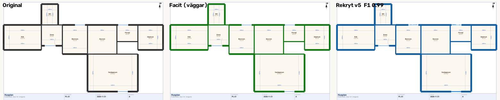
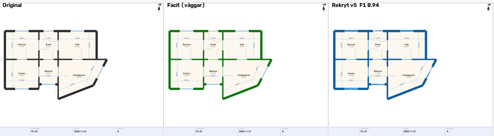
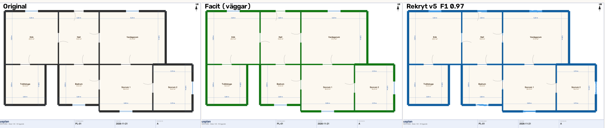
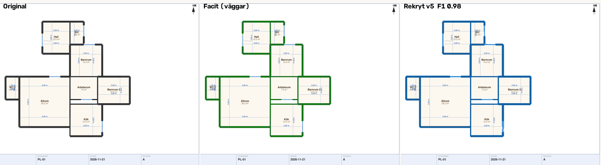

# Rekryt: wall detection for house floor plans

Rekryt is the wall detector in VDB, a Swedish house-design CAD application. You upload a floor-plan image, Rekryt finds
the walls, and VDB turns them into an editable drawing. The AI architect can then change that drawing on request.

**Training data:** Rekryt is trained from scratch on openly licensed data
([Swiss Dwellings](https://zenodo.org/records/7788422) by Archilyse AG, CC BY 4.0) and VDB's own synthetic drawings.
**It is not trained on CubiCasa5K.**

This repository holds results only. The model, the training data and the application code are not published.

Each image has three panels: **original | ground truth (walls, green) | Rekryt v5 (blue)**.

## On VDB's own drawings

The test set is 57 plans exported from VDB itself: 17 start houses and 40 generated houses. The ground truth comes straight
from the drawing's own geometry. The whole A3 sheet goes in as an uploaded drawing would, frame and title block included.

**Best case (F1 0.99)**

**Worst case (F1 0.94)**

**Typical cases (F1 0.975)**

| Set | n | Precision | Recall | F1 mean | F1 median | F1 min–max |
|---|---|---|---|---|---|---|
| All own drawings | 57 | 0.948 | 0.997 | 0.971 | 0.975 | 0.937–0.992 |
| Start houses | 17 | 0.927 | 0.995 | 0.960 | 0.962 | 0.937–0.979 |
| Generated houses | 40 | 0.956 | 0.998 | 0.976 | 0.978 | 0.958–0.992 |

## On real drawings

Real drawings are harder: they are scanned, older and drawn in many different styles.

| Set | n | Precision | Recall | F1 mean | F1 median | F1 min–max |
|---|---|---|---|---|---|---|
| CVC-FP (scanned floor plans, research dataset) | 122 | 0.807 | 0.973 | 0.881 | 0.886 | 0.573–0.951 |
| Real archive drawings | 34 | 0.792 | 0.937 | 0.845 | 0.867 | 0.518–0.997 |

For comparison, the wall detector VDB used before Rekryt scored F1 0.823 (precision 0.784, recall 0.876) on the same 122
CVC-FP plans.

## How it is measured

- **Recall** is the share of ground-truth wall pixels that Rekryt finds. **Precision** is the share of Rekryt's wall pixels
  that lie on a real wall. A pixel counts as a hit within a tolerance of max(2 px, 0.4 % of the image's longest side).
- The numbers on VDB's own drawings are much higher than on real drawings, because the clean CAD style is easier.
  Compare like with like: **0.97 recall is not a general accuracy.**
- Houses kept for final evaluation are not shown here.

## Related

- [vdb-amd-results](https://github.com/andreeludvigsson/vdb-amd-results): how VDB's AI architect was trained on an AMD
  Instinct MI300X.
- **One step at a time: Sweden first, then the Nordics, then Europe, then the world.**

---

Results as of 2026-11-21.
