# Rekryt: wall detection for house floor plans

Rekryt is the wall detector in VDB, a Swedish house-design CAD application. You upload a floor-plan image, Rekryt finds
the walls, and VDB turns them into an editable drawing. The AI architect can then change that drawing on request.

**Training data:** Rekryt is trained from scratch on openly licensed data
([Swiss Dwellings](https://zenodo.org/records/7788422) by Archilyse AG, CC BY 4.0) and VDB's own synthetic drawings.

This repository holds results only. The model, the training data and the application code are not published.

## Rekryt vs CubiCasa5K on real scanned floor plans

Measured on the **CVC-FP** dataset: 122 real, scanned floor plans with hand-made wall ground truth. Rekryt had never seen
this dataset before it was measured.

| Model | F1 mean | F1 median | Worst plan | Best plan |
|---|---:|---:|---:|---:|
| **Rekryt v5** | **0.881** | **0.886** | 0.573 | **0.951** |
| CubiCasa5K (official pretrained model) | 0.855 | 0.858 | 0.748 | 0.927 |

**Rekryt is better on 102 of the 122 plans.** The difference in mean F1 is **+0.026** (95 % confidence interval
+0.018 to +0.034, paired bootstrap over the 122 plans).

CVC-FP's images cannot be shown here for licence reasons, so only the numbers are given.

## Real drawings: HABS, public domain

Measured floor plans of real houses from the **Historic American Buildings Survey** (U.S. National Park Service), all in
the public domain. Older drawings with hatching, dimension chains and handwriting. These sheets have no ground truth,
so they are shown side by side without scores. Sources: [HABS.md](HABS.md).

Panels: **original | CubiCasa5K | Rekryt v5**, walls in the same colour.

**Thick hatched masonry on stone-patterned ground**

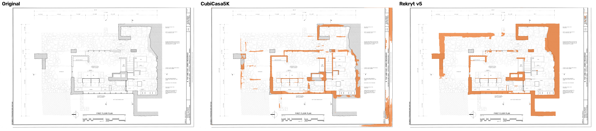

**A plan with an octagonal room**

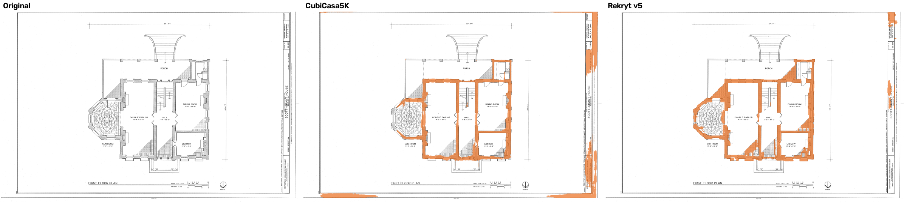

**Heavy stippled masonry, dimension lines and running text**

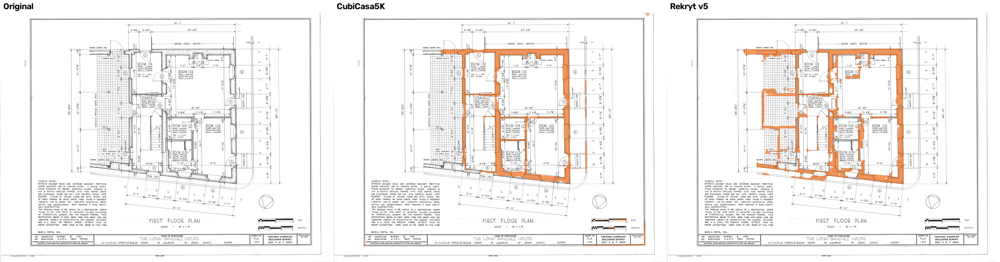

**Dense hatching and patterned fills**

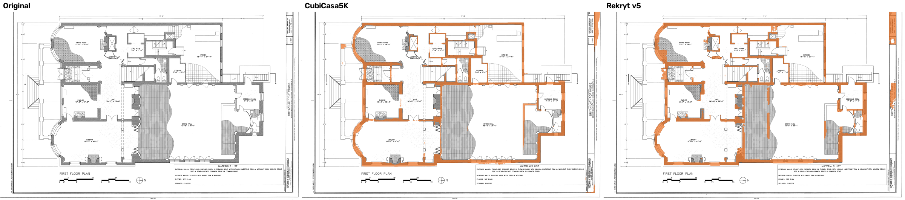

<b>Six more HABS sheets</b>

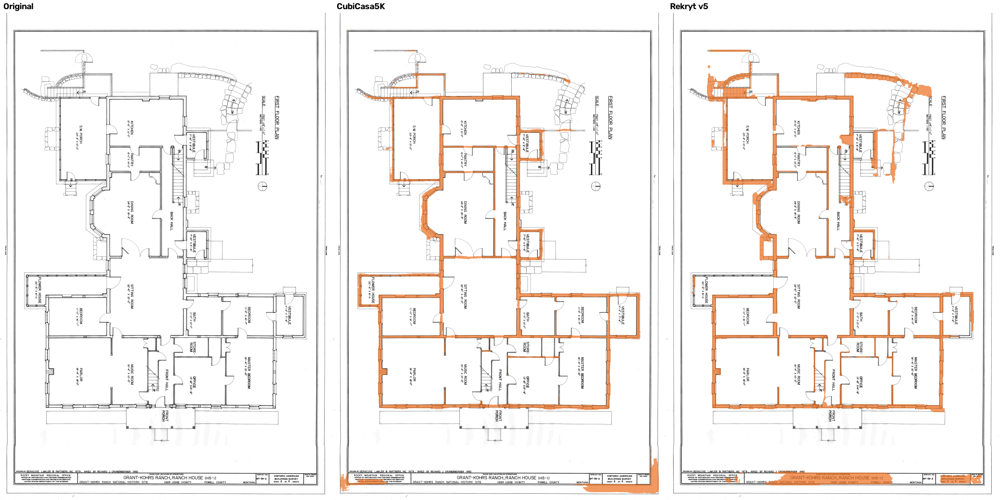

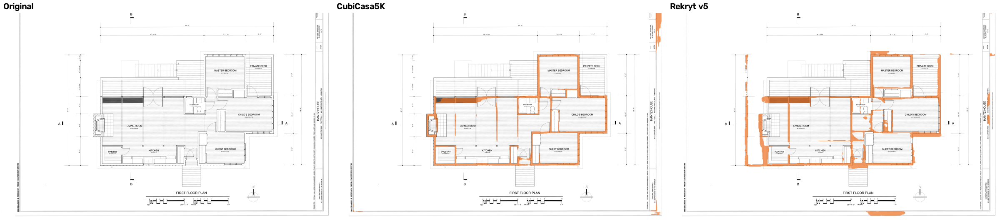

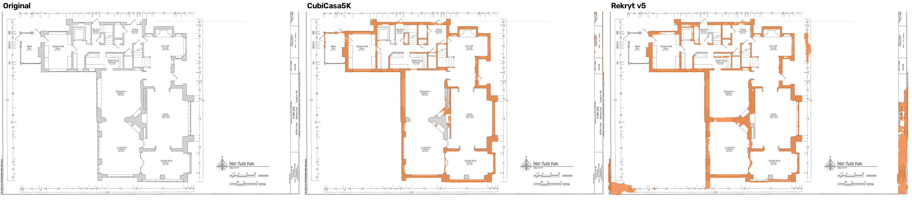

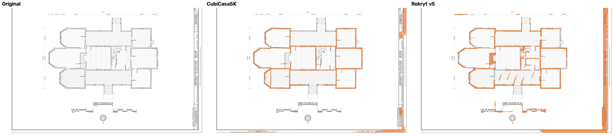

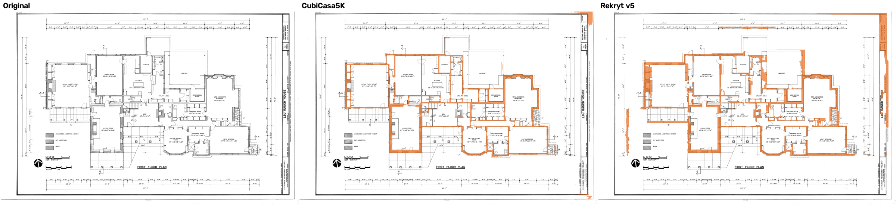

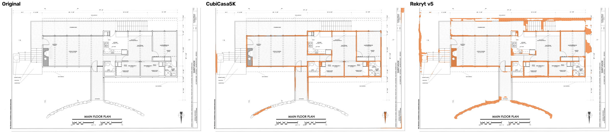

## VDB's own drawings

57 plans exported from VDB itself: 17 start houses and 40 generated houses. The ground truth (facit) comes straight from
the drawing's own geometry. The whole sheet goes in as an uploaded drawing would, frame and title block included.
Panels: **original | ground truth | CubiCasa5K | Rekryt v5**.

| Model | Precision | Recall | F1 mean | F1 median | F1 min–max |
|---|---:|---:|---:|---:|---:|
| **Rekryt v5** | **0.948** | **0.997** | **0.971** | **0.975** | **0.937**–**0.992** |
| CubiCasa5K | 0.942 | 0.996 | 0.968 | 0.970 | 0.915–0.986 |

Rekryt is better on 37 of the 57 drawings (+0.004 mean F1, 95 % CI +0.001 to +0.007).

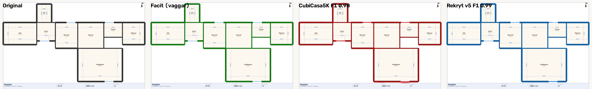

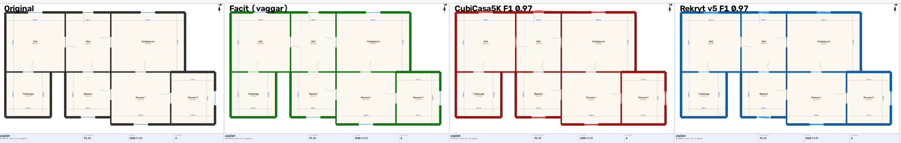

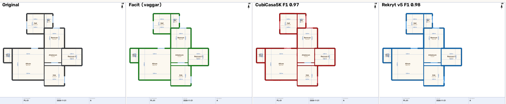

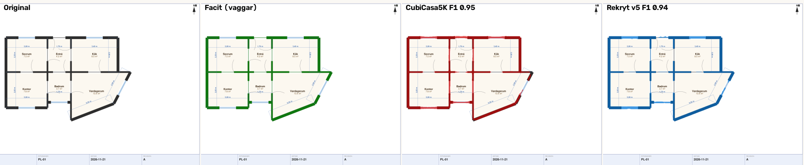

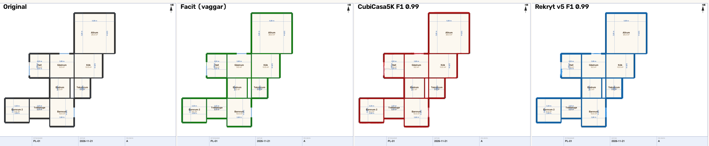

## How it is measured

- **Recall** is the share of ground-truth wall pixels a model finds. **Precision** is the share of a model's wall pixels
  that lie on a real wall. A pixel counts as a hit within max(2 px, 0.4 % of the image's longest side). F1 combines both.
- CubiCasa5K is the official pretrained model (Kalervo et al., 2019), run with the authors' own test procedure and the
  better of two input sizes.
- The same ground truth, tolerance and plans are used for both models.
- Houses kept for final evaluation are not shown here.

## Sources and licences

- HABS sheets: Historic American Buildings Survey, U.S. National Park Service, public domain. Each sheet's source is
  linked in [HABS.md](HABS.md).
- CVC-FP: de las Heras, Terrades, Robles, Sánchez, "CVC-FP and SGT: a new database for structural floor plan analysis
  and its groundtruthing tool", IJDAR 2015.
- CubiCasa5K: Kalervo, Ylioinas, Häikiö, Karhu, Kannala, "CubiCasa5K: A Dataset and an Improved Multi-Task Model for
  Floorplan Image Analysis", SCIA 2019. Model and weights CC BY-NC 4.0, used here only for comparison; neither is part of VDB.
- Swiss Dwellings: Archilyse AG, CC BY 4.0.

## Related

- [vdb-amd-results](https://github.com/andreeludvigsson/vdb-amd-results): how VDB's AI architect was trained on an AMD
  Instinct MI300X.
- **One step at a time: Sweden first, then the Nordics, then Europe, then the world.**

---

Results as of 2026-11-22.
